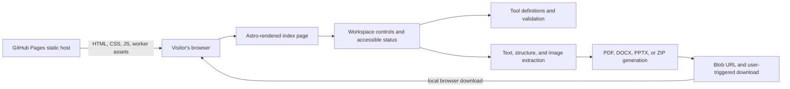
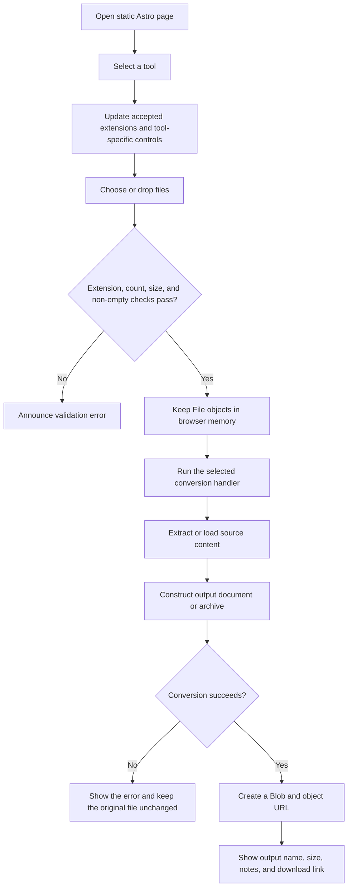

# Scriptorium — Project Documentation

> Implementation guide for the browser-based document workspace. This guide
> describes the application as implemented in the repository; it does not
> describe a server or API that does not exist.

## Table of contents

1. [Overview](#1-overview)
2. [Architecture and data flow](#2-architecture-and-data-flow)
3. [Repository structure](#3-repository-structure)
4. [Frontend implementation](#4-frontend-implementation)
5. [Conversion catalogue and workflows](#5-conversion-catalogue-and-workflows)
6. [Important modules, types, and algorithms](#6-important-modules-types-and-algorithms)
7. [Dependencies and runtime requirements](#7-dependencies-and-runtime-requirements)
8. [Validation, errors, and debugging](#8-validation-errors-and-debugging)
9. [Development, testing, and deployment](#9-development-testing-and-deployment)
10. [Git and maintenance](#10-git-and-maintenance)
11. [Verified limitations and possible improvements](#11-verified-limitations-and-possible-improvements)

## 1. Overview

Scriptorium is a single-page document workspace for PDF, Word, PowerPoint, and
image tasks. Visitors choose a tool, select or drop local files, optionally
configure that tool, run the conversion in the browser, and download the
generated file. There is no user account, document upload endpoint, application
server, database, or server-side conversion worker in this repository.

The project is a statically generated Astro site. Astro renders the page, while
one browser-side TypeScript module owns tool selection, validation, conversion,
progress feedback, and downloads. Conversion libraries are imported when their
features are used, and generated outputs are held in browser memory as `Blob`
objects.

### Technology at a glance

| Area                          | Implementation                                  |
| ----------------------------- | ----------------------------------------------- |
| UI and page generation        | Astro 7, semantic HTML, CSS                     |
| Browser behavior              | TypeScript, DOM APIs, Web APIs                  |
| PDF reading/rendering         | PDF.js (`pdfjs-dist`)                           |
| PDF creation/editing          | `pdf-lib`                                       |
| Word extraction               | Mammoth plus JSZip/OOXML supplemental parsing   |
| Word creation                 | `docx`                                          |
| PowerPoint extraction         | JSZip, XML DOM parsing, relationship resolution |
| PowerPoint creation           | PptxGenJS                                       |
| Image handling                | `ImageBitmap`, `canvas`, browser Blob APIs      |
| PDF page archive              | JSZip                                           |
| Tests                         | Vitest                                          |
| Static hosting and deployment | GitHub Pages and GitHub Actions                 |

### Application shape



The GitHub Pages host serves the site bundle only. The arrows from extraction
through download are browser-local; the selected documents are not submitted
to the host.

## 2. Architecture and data flow

### Runtime flow



### Browser-only processing boundary

`src/pages/index.astro` provides the markup and imports
`src/scripts/workspace.ts`. That script reads file inputs and drag-and-drop
events, then calls functions from the `src/lib` modules. PDF.js, `pdf-lib`,
Mammoth, JSZip, `docx`, and PptxGenJS operate in the page. Canvas rendering and
Blob URLs are also browser APIs. No HTTP API request is made by the conversion
flow.

The browser stores selected `File` objects and intermediate data in memory.
There is no persistent application-side file store. The browser's normal
download mechanism handles the final file after the visitor clicks its
download link.

### Progress and motion flow

```mermaid
sequenceDiagram
    participant User
    participant UI as Workspace UI
    participant Handler as Conversion handler
    participant Browser as Browser APIs

    User->>UI: Start conversion
    UI->>UI: Disable conflicting controls; set aria-busy
    UI->>UI: Show indeterminate progress until measurable work begins
    UI->>Handler: convert(progress callback)
    loop Measurable page/file work
        Handler->>UI: report(percent, current task label)
        UI->>Browser: Render / parse / encode current unit
    end
    Handler->>UI: report(null, unmeasured phase label)
    Note over UI: Native progress is indeterminate; no percentage is invented
    Handler-->>UI: Blob, output filename, conversion note
    UI->>UI: Show animated result card and 100% completion
    User->>Browser: Click download
    Browser-->>User: Save the Blob URL output
```

PDF/image loops report page- or file-based progress. Some parsing, Office
document generation, and final serialization do not expose byte-level or
time-based progress; those phases deliberately remove the progress element's
`value` attribute and use an indeterminate indicator instead.

## 3. Repository structure

The following is the application and configuration structure. Generated
directories and installed packages are intentionally omitted.

```text
.
├── .github/
│   └── workflows/
│       └── deploy-pages.yml
├── src/
│   ├── lib/
│   │   ├── conversion-utils.test.ts
│   │   ├── conversion-utils.ts
│   │   ├── document-extraction.ts
│   │   └── word-document.ts
│   ├── pages/
│   │   └── index.astro
│   └── scripts/
│       └── workspace.ts
├── .gitattributes
├── .gitignore
├── .prettierrc.json
├── astro.config.mjs
├── eslint.config.mjs
├── LICENSE
├── package-lock.json
├── package.json
├── README.md
├── THIRD_PARTY_NOTICES.md
└── tsconfig.json
```

| Path                                 | Responsibility and connections                                                                                                                                                                                                                                              |
| ------------------------------------ | --------------------------------------------------------------------------------------------------------------------------------------------------------------------------------------------------------------------------------------------------------------------------- |
| `.github/workflows/deploy-pages.yml` | On pushes to `main` or a manual dispatch, installs dependencies with Node 24, runs tests, lint, and build, then deploys `dist` to GitHub Pages.                                                                                                                             |
| `src/pages/index.astro`              | The only Astro page. It defines the page metadata, navigation, hero, tool chooser, upload/settings/result UI, explanatory sections, responsive CSS, motion styles, and imports the workspace script. Tool labels and tool grouping are imported from `conversion-utils.ts`. |
| `src/scripts/workspace.ts`           | Browser-side application controller and conversion dispatcher. It binds page controls, validates selections, loads/extracts files, generates outputs, updates progress and status, and creates download links. It depends on all three `src/lib` modules.                   |
| `src/lib/conversion-utils.ts`        | Tool configuration, shared limits, input validation, filename/size helpers, page-range parsing, slide-text splitting, and safe PowerPoint slide-path resolution. Imported by the workspace and tests.                                                                       |
| `src/lib/document-extraction.ts`     | Shared semantic document model and extractors for Word HTML/OOXML, PDF text, and embedded images. Used by conversion handlers, Word/PPTX generation, and tests.                                                                                                             |
| `src/lib/word-document.ts`           | Converts shared document sections and blocks into styled DOCX files using `docx`. Called by Word-producing conversion handlers.                                                                                                                                             |
| `src/lib/conversion-utils.test.ts`   | Vitest tests for validation, page selection, document parsing, slide grouping, relationship safety, and generated Word content.                                                                                                                                             |
| `astro.config.mjs`                   | Configures a static Astro build, the GitHub Pages site URL, the `/sricptum_repo` base path, and directory-formatted output.                                                                                                                                                 |
| `package.json` / `package-lock.json` | Scripts, direct dependencies, development dependencies, and reproducible dependency versions.                                                                                                                                                                               |
| `tsconfig.json`                      | Extends Astro's strict TypeScript configuration and includes `src`, tests, and the Astro config.                                                                                                                                                                            |
| `eslint.config.mjs`                  | ESLint configuration for JavaScript, TypeScript, and Astro, ignoring generated and installed directories.                                                                                                                                                                   |
| `.prettierrc.json`                   | Enables the Astro Prettier plugin.                                                                                                                                                                                                                                          |
| `.gitattributes`                     | Enables automatic text-file line-ending normalization.                                                                                                                                                                                                                      |
| `.gitignore`                         | Excludes dependencies, generated builds, caches, coverage, local environment files, and Python cache files.                                                                                                                                                                 |
| `README.md`                          | User-facing product summary, available tools, conversion caveats, local setup, checks, and privacy statement.                                                                                                                                                               |
| `THIRD_PARTY_NOTICES.md`             | Names the principal open-source dependencies and their licenses; it asks maintainers to re-check notices before redistribution.                                                                                                                                             |
| `LICENSE`                            | Repository license text. Review this file directly for the legal terms that apply to this checkout.                                                                                                                                                                         |

There are no checked-in backend, API-route, database, or separate component
directories. The application UI is authored in one Astro page; shared
conversion logic lives in TypeScript modules.

## 4. Frontend implementation

### Page layout and navigation

The Astro page uses semantic `<header>`, `<nav>`, `<main>`, `<section>`,
`<aside>`, `<article>`, and `<footer>` elements. Navigation is implemented with
in-page anchors: `#home`, `#workspace`, `#how-it-works`, and `#privacy`. Tool
choices are real buttons with `aria-pressed` state, not route links.

The workspace is assembled from:

1. A tool sidebar generated from `TOOL_GROUPS` and `TOOLS`.
2. A selected-tool heading and output-format badge.
3. A file drop zone and native file input.
4. Optional page-range or compression settings.
5. A convert button, progress indicator, status message, and result region.

The page advertises that files stay on the device. Tool descriptions and
conversion details also state the relevant limitations, such as no OCR or
image-only PDF compression.

### Styling and responsive behavior

The page's CSS is scoped in the `<style>` block in `index.astro`. It uses a
small set of CSS custom properties for the color palette, standard CSS grid and
flex layouts, fluid heading sizes, and explicit visible focus outlines. The
implemented responsive breakpoints are:

| Breakpoint         | Behavior                                                                         |
| ------------------ | -------------------------------------------------------------------------------- |
| `max-width: 900px` | Tightens page gutters and workspace columns.                                     |
| `max-width: 680px` | Adapts the header, hero, workspace/sidebar, steps, and privacy panel for mobile. |
| `max-width: 370px` | Further compresses the header and stacks the explanatory steps.                  |

Browser verification during this change checked viewport widths of 320px and
1440px with no horizontal document overflow. This is a targeted check, not a
claim that every possible viewport or browser has been visually tested.

### Client-side tool behavior

`workspace.ts` binds the controls at module initialization when `[data-tool]`
buttons are present. `renderOperation` updates accepted file extensions,
single/multiple-file selection, tool title and description, optional settings,
and active-button accessibility state. It then clears the previous selection
and output.

The file input and drop zone both call `chooseFiles`. The shared validator
checks count, filename extension, empty files, per-file size, and aggregate
size. Merge file rows include up/down controls so their displayed order is the
PDF append order. Selected files are not uploaded.

The compression control requires an explicit confirmation because that
operation rasterizes pages and removes selectable text and interactive PDF
features. The split control accepts page numbers and ascending ranges.

### Animation and accessibility behavior

The animation system uses CSS transitions/keyframes and a single
`IntersectionObserver`; it adds no animation dependency.

- Elements marked `data-reveal` are observed once. When they enter the
  viewport, `is-visible` is added and the element fades/slides into place.
- The three explanatory step cards use short, fixed CSS transition delays for
  a restrained stagger.
- Newly selected file rows animate into place.
- The status message animates when updated; result cards animate when created.
- Activating a download link announces that the download was started and
  directs the user to the browser's downloads. Browser APIs do not report
  reliably when the file has finished writing, so the application does not
  claim to know that it completed.
- Buttons, tool selection, focusable controls, and drag-over state use short
  transitions and visual feedback.
- An unmeasured conversion phase shows an indeterminate progress bar whose
  highlight moves continuously; measured page/file loops use the reported
  progress value.
- `prefers-reduced-motion: reduce` skips observer setup, disables transitions
  and animations, stops smooth scrolling, and forces any already-observed
  content visible. This also handles a preference change while the page is
  open.
- If `IntersectionObserver` is unavailable or reduced motion is requested,
  reveal styling is not enabled and content stays visible.

The visual animation checks made for this update exercised scroll reveals,
reduced-motion behavior, narrow and desktop widths, an animated validation
message, indeterminate progress, and a real PDF-to-DOCX completion in the
integrated browser. The repository does not currently define a cross-browser
animation test suite.

### Backend and network services

There is **no backend implementation** in this project. Consequently, there
are no API endpoints, request/response contracts, server upload handling,
server temporary files, or remote conversion services to document. File
validation and conversion happen in the browser. GitHub Pages serves the
static web assets only.

| Interface                         | Exists? | Details                                                                                                     |
| --------------------------------- | ------- | ----------------------------------------------------------------------------------------------------------- |
| Application REST/GraphQL endpoint | No      | The repository defines no application API routes.                                                           |
| File upload endpoint              | No      | `File` objects are read by browser code; they are not posted to a conversion server.                        |
| Conversion request/response       | No      | Conversion is an in-page function call that returns a `Blob` plus a filename and optional explanatory text. |
| Static hosting                    | Yes     | GitHub Pages returns the built site and its assets; it does not receive document conversion requests.       |

## 5. Conversion catalogue and workflows

### Supported operations

The canonical operation names, extensions, output labels, user-facing
descriptions, and per-tool file counts are in `TOOLS` in
`src/lib/conversion-utils.ts`.

| Tool               | Input → output                                 | Selection and processing limits                                                                             | Main implementation                              |
| ------------------ | ---------------------------------------------- | ----------------------------------------------------------------------------------------------------------- | ------------------------------------------------ |
| PDF to Word        | One `.pdf` → `.docx`                           | 30 MB/file, 80 MB selected total, up to 100 pages; rendered page images are also capped at 80 MB in memory. | PDF.js, `extractPdfPages`, `createWordDocument`  |
| Word to PDF        | One `.docx` → `.pdf`                           | 30 MB/file, 80 MB selected total.                                                                           | Mammoth, JSZip, `createTextPdf`, `pdf-lib`       |
| PowerPoint to Word | One `.pptx` → `.docx`                          | 30 MB/file, 80 MB selected total; 1–80 standard slides.                                                     | JSZip/XML, `extractSlides`, `createWordDocument` |
| Word to PowerPoint | One `.docx` → `.pptx`                          | 30 MB/file, 80 MB selected total; generated deck capped at 80 slides including image slides.                | Mammoth, structured slide splitter, PptxGenJS    |
| PowerPoint to PDF  | One `.pptx` → `.pdf`                           | 30 MB/file, 80 MB selected total; 1–80 standard slides.                                                     | JSZip/XML, `extractSlides`, `createTextPdf`      |
| PDF to PowerPoint  | One `.pdf` → `.pptx`                           | 30 MB/file, 80 MB selected total; source is limited to 80 pages and final deck to 80 slides.                | PDF.js, `extractPdfPages`, PptxGenJS             |
| Compress PDF       | One `.pdf` → `.pdf`                            | 30 MB/file, 80 MB selected total, at most 50 pages.                                                         | PDF.js, canvas/JPEG, `pdf-lib`                   |
| Merge PDFs         | 2–10 `.pdf` files → `.pdf`                     | Each file at most 30 MB, aggregate 80 MB, merged result at most 100 pages.                                  | `pdf-lib`                                        |
| Split PDF          | One `.pdf` → `.pdf`                            | 30 MB/file, 80 MB selected total, at most 100 pages.                                                        | `pdf-lib`, `parsePageRanges`                     |
| Images to PDF      | 1–20 `.png`, `.jpg`, `.jpeg`, `.webp` → `.pdf` | Each file at most 30 MB, aggregate 80 MB, each image at most 80 megapixels.                                 | `ImageBitmap`, canvas/JPEG, `pdf-lib`            |
| PDF to images      | One `.pdf` → `.zip` of PNG pages               | 30 MB/file, 80 MB selected total, at most 50 pages.                                                         | PDF.js, canvas, JSZip                            |

All tools share the global 30 MB per-file and 80 MB aggregate input limits.
File type validation uses the filename extension, case-insensitively; it is
not a MIME-signature security scanner. Format compatibility and parser checks
are also performed by the relevant conversion library.

### Shared output process

`convert` chooses a handler using the selected `OperationId`. Each handler
returns a `Blob`, an output filename, and optionally a note describing
preservation behavior or limitations. `finish` creates a local object URL,
displays the output size and explanatory note, and adds a download link. The
visitor starts the download by activating that link.

Starting a new operation, choosing new files, or clearing selection revokes
the previous object URL. This avoids keeping an obsolete output URL alive
after it is no longer usable.

### PDF to Word

1. `loadPdf` reads the selected file into a `Uint8Array` and opens it with
   PDF.js. It rejects files above the per-file limit and documents above 100
   pages for this tool.
2. `extractPdfPages` walks pages in order. It reads PDF.js text items and calls
   `extractPdfPageText` to join text items while using their coordinates,
   widths, line heights, and end-of-line flags to infer spaces and line
   boundaries.
3. The same source page is rendered at scale 1.3 to a canvas and encoded as
   JPEG at quality 0.84. Rendered images together may not exceed 80 MB.
4. `structurePlainText` classifies extracted text lines as paragraphs,
   heuristic uppercase headings, or bullet/numbered list items.
5. Each page becomes two Word sections: a visual image of the original page,
   then its editable extracted text. A text-free/scanned page gets an explicit
   no-selectable-text message; OCR is not performed.
6. `createWordDocument` produces the styled DOCX, which is returned as
   `<safe-name>-preserved.docx`.

The output preserves page appearance as images and text as editable
paragraphs; it does not reconstruct the PDF's exact original Word layout.

### Word to PDF

1. `extractWordContent` sends the `.docx` byte buffer to Mammoth for raw text
   and semantic HTML, including embedded images as data URLs.
2. `parseWordHtml` maps paragraphs, headings, lists, and tables into
   `DocumentBlock` values.
3. JSZip scans relevant Word XML parts for headers, footers, footnotes,
   endnotes, and comments and appends their text as paragraph blocks. Embedded
   image data is decoded and normalized.
4. `createTextPdf` draws the structured blocks on A4 pages using built-in
   Helvetica fonts, wraps long lines, styles headings and tables, and appends
   retained images on separate pages.
5. The result is `<safe-name>.pdf`.

The exported PDF is a newly laid-out, text-first document. It does not render
the source DOCX layout. The built-in PDF fonts can reject unsupported
characters or writing systems, in which case the conversion reports an error
instead of silently substituting text.

### PowerPoint to Word

1. `extractSlides` opens the `.pptx` ZIP and parses
   `ppt/presentation.xml` plus its relationship file.
2. `resolvePresentationSlidePaths` validates every slide relationship and
   returns the referenced slide XML files in presentation order. The
   PowerPoint must contain 1–80 standard slides.
3. Each slide's text is read from XML runs. Title and subtitle placeholders
   become headings; bullet/numbered paragraph properties become list items;
   table cells become table blocks.
4. Slide relationships are inspected for speaker notes, chart data, and
   embedded images. Notes are added as structured text; chart cached `<c:v>`
   values are added as a text paragraph; referenced media is normalized and
   deduplicated.
5. `createWordDocument` writes one section per slide and separate sections
   for retained presentation images.
6. The result is `<safe-name>-text.docx`.

Chart values are cached values stored in the PowerPoint package, not a fresh
recalculation of chart formulas. Slide layout, chart visuals, animations,
audio, and other interactive presentation behavior are not recreated.

### Word to PowerPoint

1. `extractWordContent` extracts text, semantic blocks, supplemental text,
   and supported images from the DOCX.
2. `splitDocumentBlocksIntoSlides` groups blocks into slide-sized groups
   (default text budget 520 characters), starts a new slide at headings, and
   splits long paragraphs or tables across groups while retaining table
   headers where available.
3. The handler checks that content slides plus embedded-image slides do not
   exceed 80 slides.
4. `savePresentation` creates styled editable slides. Headings, paragraphs,
   lists, and tables use separate PowerPoint elements; retained images go on
   additional slides.
5. The result is `<safe-name>.pptx`.

Generated slide layout is a consistent Scriptorium layout, not a reproduction
of the source Word pagination or typography.

### PowerPoint to PDF

1. `extractSlides` resolves slide order and extracts text blocks, tables,
   notes, chart cache values, and supported images.
2. The handler builds one text-first PDF section per slide, with a heading
   identifying its original slide number.
3. `createTextPdf` renders the text and tables on A4 pages and places retained
   images on separate pages after the text.
4. The result is `<safe-name>-text.pdf`.

The original slide canvas, exact layout, charts, transitions, and animations
are not rendered as slide screenshots.

### PDF to PowerPoint

1. `extractPdfPages` reads selectable text and renders a JPEG image for each
   source page. The source is limited to 80 pages, and the same 80 MB rendered
   image cap applies.
2. The text for each page is split into segments of at most 850 characters by
   `splitTextIntoSlides`. The output is rejected if the total page and
   continuation slides exceed 80.
3. `savePresentation` places the original page image beside editable text on
   the page's first slide, adds the full extracted text to speaker notes, and
   adds styled text-only continuation slides when required.
4. The result is `<safe-name>.pptx`.

PDF text line breaks are normalized when text is split into slide segments.
The presentation keeps the extracted text content, but its original reading
order, layout, and formatting cannot be guaranteed from PDF text coordinates.
Scanned/image-only pages are preserved visually but are not OCR-converted.

### Compress PDF

1. The input is opened with PDF.js and limited to 50 pages.
2. The visitor must accept the warning that compression removes selectable
   text, forms, links, and other interactive/accessibility features.
3. Each page is rendered to canvas and encoded as JPEG using the selected
   preset:

   | Preset                    | Render scale | JPEG quality |
   | ------------------------- | -----------: | -----------: |
   | Best clarity (`standard`) |         1.35 |         0.78 |
   | Balanced                  |         1.00 |         0.64 |
   | Smaller file (`compact`)  |         0.75 |         0.48 |

4. `pdf-lib` creates a new page containing only the rendered image.
5. A comparison note reports whether the output is smaller or suggests
   trying the compact setting. The result is
   `<safe-name>-compressed.pdf`.

Compression is rasterization, not lossless PDF object optimization. If the
result is larger than the source, the UI says so.

### Merge PDFs

1. The user selects 2–10 valid PDF files. The file list exposes arrow controls
   to arrange the order.
2. Each source is loaded by `pdf-lib`; `copyPages` copies source pages into a
   new document in the displayed order.
3. The operation rejects a merged document above 100 pages.
4. The result is `<first-file-safe-name>-merged.pdf`.

### Split PDF

1. The PDF is read and its page count is checked against the 100-page limit.
2. `parsePageRanges` accepts comma-separated page numbers and ascending
   ranges, such as `1-3, 5`. It rejects invalid syntax, duplicates, descending
   ranges, zero, and values beyond the source page count.
3. `pdf-lib` copies the selected pages in the requested order into a new PDF.
4. The result is `<safe-name>-selected-pages.pdf`.

### Images to PDF

1. The user selects 1–20 PNG, JPEG, or WebP images.
2. `createImageBitmap` opens each image. Inputs above 80 megapixels are
   rejected.
3. Each image is drawn onto a white canvas and encoded to JPEG at quality
   0.90. `pdf-lib` embeds it on a separate A4 or landscape A4 page, scaled to
   fit within margins.
4. The result is `<first-file-safe-name>-images.pdf`.

The PDF contains raster images, not editable image text; image metadata and
transparency may not be retained after JPEG encoding.

### PDF to images

1. PDF.js opens a document limited to 50 pages.
2. Every page is rendered at scale 1.5 and encoded as PNG.
3. JSZip packages the pages as
   `<safe-name>-page-001.png`, `<safe-name>-page-002.png`, and so on.
4. The result is `<safe-name>-pages.zip`.

This tool exports page images only; it does not extract text.

## 6. Important modules, types, and algorithms

### Shared types

| Type                   | File                             | Meaning                                                                         |
| ---------------------- | -------------------------------- | ------------------------------------------------------------------------------- |
| `OperationId`          | `src/lib/conversion-utils.ts`    | Union of the keys in `TOOLS`; constrains valid UI operations.                   |
| `DocumentBlock`        | `src/lib/document-extraction.ts` | Discriminated union for paragraph, heading, list-item, and table content.       |
| `TextDocumentBlock`    | `src/lib/document-extraction.ts` | `DocumentBlock` excluding tables, used by line-based plain-text classification. |
| `ExtractedImage`       | `src/lib/document-extraction.ts` | Image bytes, MIME type, and pixel dimensions.                                   |
| `ExtractedWordContent` | `src/lib/document-extraction.ts` | Raw text, structured blocks, and images extracted from a DOCX.                  |
| `WordDocumentSection`  | `src/lib/word-document.ts`       | Optional heading, plain text/blocks, or one retained image for a DOCX section.  |
| `PdfTextItem`          | `src/lib/document-extraction.ts` | The subset of PDF.js text-item fields used for line/space reconstruction.       |

### Conversion configuration and validation

| Function                                                   | Parameters → return                                                               | Purpose and callers                                                                                                                                       |
| ---------------------------------------------------------- | --------------------------------------------------------------------------------- | --------------------------------------------------------------------------------------------------------------------------------------------------------- |
| `getFileExtension(name)`                                   | Filename → lowercase suffix or empty string                                       | Used by input validation; extension-based, not MIME sniffing.                                                                                             |
| `isOperationId(value)`                                     | String → type guard                                                               | Prevents unknown `data-tool` values from reaching the dispatcher.                                                                                         |
| `validateInputFiles(operation, files)`                     | Operation and `File[]` → optional error string                                    | Enforces count, merge minimum, accepted extension, non-empty file, per-file limit, and total limit; used on selection and again before conversion.        |
| `safeFileStem(name)`                                       | Filename → sanitized stem                                                         | Removes the extension, normalizes Unicode, replaces unsafe filename characters, trims trailing dots/spaces, and caps output length at 100 characters.     |
| `formatFileSize(bytes)`                                    | Byte count → readable string                                                      | Formats byte, KB, or MB values for selected and generated files.                                                                                          |
| `parsePageRanges(input, pageCount)`                        | Range string and page count → page numbers                                        | Validates and expands ascending comma-separated numbers/ranges, rejecting duplicates and out-of-range values.                                             |
| `splitTextIntoSlides(text, maxCharacters)`                 | Text and optional character cap → string segments                                 | Splits on whitespace, joins normalized words into bounded segments, and splits overlong individual words. Used for PDF-to-PowerPoint continuation slides. |
| `resolvePresentationSlidePaths(ids, relationships, files)` | Relationship IDs, relationship map, available package paths → ordered slide paths | Validates standard slide references, rejects unsafe/duplicate/missing targets, and follows presentation order rather than ZIP filename order.             |

### Extraction and structure

| Function                                               | Parameters → return                                          | Purpose and callers                                                                                                                                                                                |
| ------------------------------------------------------ | ------------------------------------------------------------ | -------------------------------------------------------------------------------------------------------------------------------------------------------------------------------------------------- |
| `parseWordHtml(html)`                                  | Mammoth HTML → `DocumentBlock[]`                             | Parses headings, paragraphs, nested lists, and tables. Throws on parser errors.                                                                                                                    |
| `readList(list, level, blocks)`                        | List element, nesting level, output blocks → `void`          | Internal recursive helper that distinguishes ordered/unordered items and preserves bounded nesting.                                                                                                |
| `documentBlockText(block)`                             | One block → readable text                                    | Produces a plain-text representation, including table rows and list markers; used by slide grouping.                                                                                               |
| `splitDocumentBlocksIntoSlides(blocks, maxCharacters)` | Structured blocks and optional budget → block groups         | Groups Word content by character budget, starts slides at headings, splits long paragraphs and tables, and carries table headers into continuations.                                               |
| `normalizeEmbeddedImage(data, contentType, fileName)`  | Bytes, MIME type, source filename → `ExtractedImage`         | Decodes and dimension-checks images; preserves PNG/JPEG/GIF/BMP bytes and rasterizes other supported browser-decodable formats to PNG. Rejects decode failures or images over 80 megapixels.       |
| `extractPdfPageText(items)`                            | Ordered PDF.js text items → string                           | Uses text coordinates, dimensions, and EOL markers to infer line breaks and spaces.                                                                                                                |
| `structurePlainText(text)`                             | Plain text → `TextDocumentBlock[]`                           | Heuristically treats marked bullet/number lines as list items, short mostly-uppercase lines as headings, and remaining non-empty lines as paragraphs. It is not semantic PDF structure extraction. |
| `extractWordContent(file, fileName)`                   | DOCX `Blob` and diagnostic filename → `ExtractedWordContent` | Uses Mammoth raw text/HTML, `parseWordHtml`, JSZip supplemental XML scanning, and data-URL image extraction to produce shared content.                                                             |

### Document generation

| Function                                                                                          | Parameters → return                                                | Purpose and callers                                                                                                                                                                                              |
| ------------------------------------------------------------------------------------------------- | ------------------------------------------------------------------ | ---------------------------------------------------------------------------------------------------------------------------------------------------------------------------------------------------------------- |
| `createWordDocument(title, sections)`                                                             | Title and `WordDocumentSection[]` → `Promise<Blob>`                | Generates a styled DOCX with Arial defaults, title/heading styles, native numbering/bullets, actual tables, page breaks before later headed sections, and supported embedded images.                             |
| `createTextPdf(title, sections, images)`                                                          | Title, text/structured sections, optional images → `Promise<Blob>` | Internal workspace generator using `pdf-lib`; creates A4 text pages, wraps strings, draws basic tables and page furniture, validates built-in Helvetica character support, and appends images on separate pages. |
| `savePresentation(title, slides, images, useImageSlidesWithNotes, contentSlides, pageTextGroups)` | Presentation title and content/options → `Promise<Blob>`           | Internal PptxGenJS generator for text slides, structured Word slides, retained-image slides, PDF page-image/text pairs, notes, and long-text continuations. Enforces the 80-slide output limit.                  |

### Workspace and browser helpers

| Function                                  | Parameters → return                                                       | Purpose                                                                                                                                                           |
| ----------------------------------------- | ------------------------------------------------------------------------- | ----------------------------------------------------------------------------------------------------------------------------------------------------------------- |
| `getPdfjs()`                              | None → cached PDF.js module promise                                       | Dynamically imports PDF.js and its Vite-resolved worker URL, then sets `GlobalWorkerOptions.workerSrc`.                                                           |
| `imageDataBuffer(data)`                   | `Uint8Array` → copied `ArrayBuffer`                                       | Creates a safe standalone buffer for Blob/image APIs.                                                                                                             |
| `requireElement(selector)`                | CSS selector → required DOM element                                       | Throws an explicit error if expected workspace markup is absent.                                                                                                  |
| `initializeEntranceAnimations()`          | None → `void`                                                             | Adds one-time IntersectionObserver reveal behavior unless reduced motion is preferred or the API is unavailable.                                                  |
| `renderFileList()`                        | Current selected files → `void`                                           | Rebuilds selected-file rows, merge order actions, sizes, and merge guidance.                                                                                      |
| `renderOperation(operation)`              | `OperationId` → `void`                                                    | Updates labels, accepted formats, operation-specific inputs, pressed states, and clears stale selection/results.                                                  |
| `chooseFiles(files)`                      | `FileList` or `File[]` → `void`                                           | Applies shared input validation, then updates state and announces readiness/errors.                                                                               |
| `downloadBlob(blob, fileName)`            | Output Blob and filename → anchor element                                 | Creates/replaces the object URL and returns a download link; prior URLs are revoked.                                                                              |
| `finish(blob, fileName, detail)`          | Generated output metadata → `void`                                        | Builds the success card, sets completion status/progress, and scrolls the output into view.                                                                       |
| `loadPdf(file, maxPages)`                 | File and optional page cap → PDF.js document plus cleanup                 | Reads and opens a PDF, checks file/page limits, and returns a `close` cleanup callback.                                                                           |
| `createPageCanvas(viewport)`              | PDF.js viewport → canvas/context                                          | Allocates and initializes a white page canvas at the viewport dimensions. Throws if a 2D context is unavailable.                                                  |
| `extractPdfPages(file, maxPages, report)` | PDF file, page cap, progress callback → text, blocks, and rendered images | Performs selectable-text extraction and JPEG page rendering, reports page-based progress, checks total image size, and closes PDF.js in `finally`.                |
| `extractSlides(file)`                     | PPTX `File` → slide text, structured blocks, and images                   | Parses OOXML ZIP parts, validates relationship paths, reads slide order/text/tables/notes/chart cache values/images, and enforces image/presentation constraints. |
| `canvasToBlob(canvas, type, quality)`     | Canvas and encoding options → `Promise<Blob>`                             | Wraps `HTMLCanvasElement.toBlob`; rejects if the browser cannot export.                                                                                           |
| `imageFromFile(file)`                     | Image `File` → `Promise<ImageBitmap>`                                     | Uses `createImageBitmap` and returns a user-facing error if the image cannot be opened.                                                                           |
| `convert(report)`                         | Progress callback → output Blob, filename, optional detail                | Dispatches to one of the eleven conversion branches. It does not manipulate the file input directly.                                                              |
| `runConversion()`                         | None → `Promise<void>`                                                    | Revalidates, checks the compression confirmation, disables conflicting controls, runs conversion, reports errors, and restores controls in `finally`.             |

The workspace is event-driven and uses a discriminated `OperationId` plus a
single switch dispatcher; it does not create per-tool classes or server
handlers.

### Selected algorithms and safety checks

- **PDF text reconstruction:** compares consecutive item Y coordinates using
  a tolerance derived from text height, inserts line breaks when rows differ,
  and inserts spaces when the horizontal gap exceeds a text-height threshold.
- **Word semantic parsing:** walks Mammoth HTML tags, maps `h1`–`h6`,
  paragraphs, nested `ol`/`ul`, and rows/cells into typed blocks.
- **PowerPoint ordering:** obtains IDs from `p:sldIdLst`, resolves them through
  the presentation relationship map, normalizes each relative path, and
  requires it to match `ppt/slides/slideN.xml` present in the archive.
- **Output filenames:** sanitize extensionless source names before constructing
  output names; filenames never control a remote path because no server
  storage exists.
- **Memory cleanup:** PDF.js loading tasks are destroyed in `finally`; canvases
  are reset after use; image bitmaps are closed; generated object URLs are
  revoked when results are cleared or replaced.

## 7. Dependencies and runtime requirements

### Runtime and direct dependencies

The deployment workflow uses Node.js 24. The README specifies Node.js 24 or
later for local development. A current browser must support the page's
TypeScript-generated JavaScript and the web APIs used by the selected tool
(File/Blob, canvas, `createImageBitmap` for image paths, and PDF.js worker
execution).

| Package                 | Manifest section | Role in this project                                                                       |
| ----------------------- | ---------------- | ------------------------------------------------------------------------------------------ |
| `astro`                 | Runtime          | Static site generation, page compilation, dev server, bundling, and static build.          |
| `docx`                  | Runtime          | Creates Office Open XML Word documents.                                                    |
| `jszip`                 | Runtime          | Reads DOCX/PPTX ZIP containers and creates the PDF-to-images ZIP archive.                  |
| `mammoth`               | Runtime          | Extracts raw text and semantic HTML from `.docx` input.                                    |
| `pdf-lib`               | Runtime          | Creates PDFs, copies PDF pages, and embeds raster images.                                  |
| `pdfjs-dist`            | Runtime          | Reads PDF pages/text and renders page canvases in the browser.                             |
| `pptxgenjs`             | Runtime          | Generates PowerPoint presentations.                                                        |
| `@astrojs/check`        | Development      | Astro/TypeScript diagnostics invoked by the build script.                                  |
| `@eslint/js`            | Development      | ESLint's recommended JavaScript rules.                                                     |
| `@playwright/test`      | Development      | Browser automation package; it is not invoked by the configured CI workflow.               |
| `@types/node`           | Development      | Node type definitions for tooling and tests.                                               |
| `@xmldom/xmldom`        | Development      | DOM parser implementation used by Node-based tests. Browsers use their native `DOMParser`. |
| `eslint`                | Development      | JavaScript, TypeScript, and Astro linting.                                                 |
| `eslint-plugin-astro`   | Development      | Astro-specific lint rules.                                                                 |
| `prettier`              | Development      | Formatting checks and writes.                                                              |
| `prettier-plugin-astro` | Development      | Astro formatting support.                                                                  |
| `typescript`            | Development      | TypeScript compiler and type checking.                                                     |
| `typescript-eslint`     | Development      | TypeScript ESLint configuration/parser support.                                            |
| `vitest`                | Development      | Unit test runner.                                                                          |

The package manifest also overrides `image-size` to a patched 2.x release. The
complete resolved tree and exact versions are recorded in
`package-lock.json`.

### Environment configuration

No application environment variables or secrets are required by the source
code or GitHub Pages workflow. The `astro.config.mjs` contains the public
site URL and repository base path. The `.env` pattern is ignored by Git, but
there are no documented application variables to set.

## 8. Validation, errors, and debugging

### Validation and error reporting

Validation is performed before conversion and again when the user presses the
convert button. It covers:

- Supported filename extension for the selected tool.
- Required and maximum file counts.
- Empty files.
- 30 MB individual and 80 MB combined limits.
- Merge's minimum of two PDF files.
- Split page-range syntax, duplicates, and bounds.
- Compression acknowledgement.
- Tool-specific page, slide, image-dimension, generated-slide, and memory
  limits in the relevant handler.

Conversion handlers throw `Error` values with contextual messages for
malformed files, missing OOXML relationships, unsupported image encodings,
browser canvas failures, unsupported text glyphs in the built-in PDF fonts,
and size/page-limit violations. `runConversion` catches failures at the UI
boundary, displays the message in the live status region, marks it as an
error, and restores disabled controls in `finally`. It does not convert an
error into a successful-looking output.

### Debugging by symptom

| Symptom                                        | First places to inspect                                                                                                                                                                            |
| ---------------------------------------------- | -------------------------------------------------------------------------------------------------------------------------------------------------------------------------------------------------- |
| Tool accepts the wrong extension or file count | `TOOLS`, `validateInputFiles`, `renderOperation`, and the `[data-tool]` markup.                                                                                                                    |
| File does not appear or selection is rejected  | `chooseFiles`, `validateInputFiles`, file input `accept`, and drag/drop event handlers in `workspace.ts`.                                                                                          |
| PDF opens but text is missing or out of order  | `loadPdf`, `extractPdfPageText`, and PDF.js text item order/coordinates. Image-only pages require OCR, which is not implemented.                                                                   |
| PDF rendering fails                            | PDF.js worker import in `getPdfjs`, canvas creation, browser memory, and PDF.js parse errors.                                                                                                      |
| Word content/structure is missing              | Mammoth extraction, `parseWordHtml`, supplemental `word/*.xml` scanning, and DOCX contents.                                                                                                        |
| PowerPoint slides are missing or reordered     | Presentation slide IDs, `.rels` targets, `resolvePresentationSlidePaths`, and `extractSlides`.                                                                                                     |
| Speaker notes or chart values are absent       | Slide relationship file, notes XML paragraphs/placeholders, or cached chart `<c:v>` data.                                                                                                          |
| Output cannot be created                       | Relevant dynamic library import, browser canvas/Blob support, PDF font encoding, file/page/slide limits, and the generated document code.                                                          |
| Download link points to a stale result         | `clearResult`, `downloadBlob`, and object URL revocation.                                                                                                                                          |
| A section stays hidden                         | Check `prefers-reduced-motion`, `IntersectionObserver`, the `data-reveal` attribute, and whether `is-visible` is added. No-JS or unsupported-observer paths do not enable the hidden reveal state. |
| Deployed page uses an incorrect asset path     | `base` and `site` in `astro.config.mjs`, then the Pages workflow artifact and deployment result.                                                                                                   |

For browser-side debugging, use developer tools' Console and Network tabs.
Conversion work is local, so a failed conversion usually appears as a visible
workspace status message and/or a browser console error rather than a server
log. The GitHub Actions run logs are the source for CI/deployment failures.

### Logging

The application does not implement a remote logging or telemetry service.
Expected user-facing failures are rendered in `#workspace-status`; debugging
details for build/deploy failures are available in GitHub Actions. Avoid
placing document content or private filenames in public logs when debugging.

## 9. Development, testing, and deployment

### Prerequisites and setup

1. Install Node.js 24 or later and npm.
2. Clone the repository and change into its root directory.
3. Install locked dependencies and start Astro:

```powershell
npm ci
npm run dev
```

Open the local URL printed by Astro, generally
`http://localhost:4321/sricptum_repo/` because the configured base path is
`/sricptum_repo`.

On Windows PowerShell installations whose execution policy blocks
`npm.ps1`, invoke the Windows command shims explicitly, for example
`npm.cmd ci` and `npm.cmd run dev`. No `.env` file or backend startup command
is needed.

### Available commands

| Command           | Effect                                                                                             |
| ----------------- | -------------------------------------------------------------------------------------------------- |
| `npm run dev`     | Starts Astro's local development server.                                                           |
| `npm run build`   | Runs `astro check` then builds the static site to `dist/`.                                         |
| `npm run preview` | Serves the built static output locally. Build first.                                               |
| `npm test`        | Runs the Vitest suite once.                                                                        |
| `npm run lint`    | Runs ESLint over JavaScript, TypeScript, and Astro source.                                         |
| `npm run format`  | Formats the repository with Prettier. Review the resulting diff before committing.                 |
| `npm audit`       | Checks the installed dependency tree for published advisories; not included in the Pages workflow. |

The unit suite covers page ranges, slide splitting, validation, file naming,
presentation relationship ordering, Word HTML structure, PDF text line
reconstruction, and generated DOCX structure. The workflow currently runs
tests, lint, and build; it does not run browser end-to-end tests, a package
audit, or desktop Office applications.

### Static build and deployment

`astro.config.mjs` sets `output: "static"`, the GitHub Pages site URL, and the
`/sricptum_repo` base. `npm run build` produces `dist/`. The workflow
`.github/workflows/deploy-pages.yml` runs for pushes to `main` and manual
dispatches, using Node 24 and `npm ci`; after tests, lint, and build succeed,
it uploads `dist` and deploys to the `github-pages` environment.

There is no server process to deploy. The live site is:
<https://mudassir-hazoor.github.io/sricptum_repo/>.

## 10. Git and maintenance

### Current repository practices

The repository's active branch is `main`; GitHub Actions deploys that branch.
The recent commit subjects are concise, descriptive imperative phrases (for
example, “Preserve structure across document conversions”). No additional
branching or release policy is encoded in the repository, so do not assume one.

The current rewritten commit history retains Mudassir Hazoor as author and
does not contain Copilot co-author trailers. Published history was rewritten
with explicit approval before this documentation task; do not rewrite it
again without separate explicit approval.

### Adding or changing a conversion

1. Add or update a strongly typed entry in `TOOLS` and its operation ID in
   `TOOL_GROUPS` in `conversion-utils.ts`.
2. Add the corresponding button icon/metadata in `index.astro` if a new
   operation ID is introduced.
3. Implement the operation's validation/settings requirements and handler in
   the `convert` switch in `workspace.ts`.
4. Prefer shared extraction/output helpers and `DocumentBlock` values instead
   of flattening structured content or duplicating common validation.
5. Return a Blob with a sanitized output stem and a user-facing detail string
   that states preservation and format limitations.
6. Add tests for validation, parsing, and generated structure in
   `conversion-utils.test.ts`.
7. Verify responsive behavior, accessibility announcements, progress
   honesty, reduced-motion behavior, and error cleanup where affected.
8. Run tests, lint, formatting checks, and the production build before
   publishing.

Keep conversion limits and user-facing explanations synchronized between the
tool configuration, workspace UI copy, README, and this document.

## 11. Verified limitations and possible improvements

### Verified functional limits

- Accepted inputs are `.pdf`, `.docx`, `.pptx`, `.png`, `.jpg`, `.jpeg`, and
  `.webp`. Legacy `.doc` and `.ppt` are not accepted.
- PDF text extraction is not OCR. Scanned pages are retained as images in
  PDF-to-Word/PowerPoint but do not produce editable text.
- Word/PowerPoint-to-PDF and Office-to-Office outputs use newly generated
  layouts. Exact original page/slide design, typography, forms, transitions,
  or animations are not recreated.
- Word headers/footers/footnotes/endnotes/comments are included as extracted
  supplemental text where present; formatting and original placement are not
  reconstructed.
- PowerPoint output conversion keeps supported image assets and extracts
  speaker notes and cached chart values as text, but does not recreate chart
  visuals, animations, audio, or the exact slide canvas.
- PDF-to-PowerPoint cannot guarantee that reconstructed text order matches
  the original visual reading order, especially for multi-column or
  text-positioned pages.
- PDF text PDF generation uses built-in standard fonts. Unsupported glyphs or
  writing systems can cause an explicit export error.
- Compression rasterizes each page and removes selectable text, forms, links,
  and other interactive/accessibility features.
- Page, slide, file-size, total-size, rendered-image, and image-dimension
  ceilings are enforced as listed in the conversion catalogue.
- The output document formats were verified by project tests and browser
  conversion checks, but this repository does not automate opening every
  generated file in Microsoft Office, LibreOffice, or another desktop suite.

### Verified architectural and testing limits

- The application has no backend, persistent storage, accounts, or API.
- Extension-based file checks are usability validation, not file-signature
  verification. Actual parsers still need to open the selected bytes.
- Because document parsers run in the browser, browser and dependency updates
  remain important. This documentation is not a security audit or a guarantee
  against malformed-file or browser vulnerabilities.
- The CI workflow tests and builds the site but does not run automated
  cross-browser UI tests.
- Animation behavior was checked in the integrated browser at representative
  widths, with reduced motion, and through an actual PDF-to-DOCX workflow;
  that is not equivalent to testing every browser/device combination.
- Build output currently includes the bundler warning that some generated
  chunks exceed 500 kB after minification. The build still succeeds. The PDF
  and Office libraries contribute to client bundle size; further code
  splitting is a potential optimization.

### Potential future improvements (not existing features)

- Add an automated browser suite that covers all tools, errors, accessibility,
  responsive layouts, and reduced-motion preferences across supported
  browsers.
- Evaluate additional code splitting for the largest conversion libraries,
  measuring the deployed bundle and conversion startup time before changing
  import boundaries.
- Add OCR only if a privacy-preserving implementation and explicit language,
  quality, and resource limits are selected.
- Consider desktop Office/LibreOffice interoperability checks for generated
  DOCX/PPTX/PDF files.
